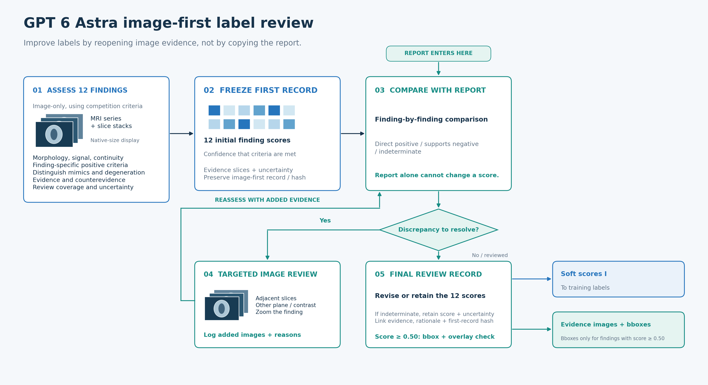
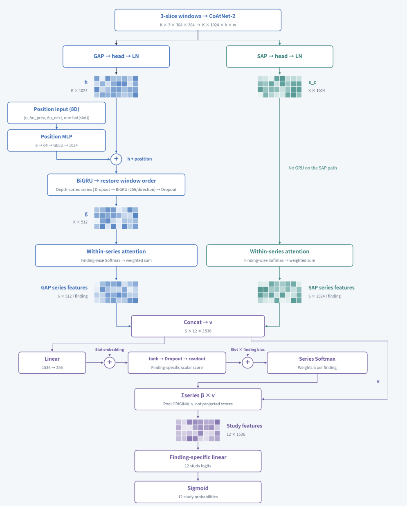
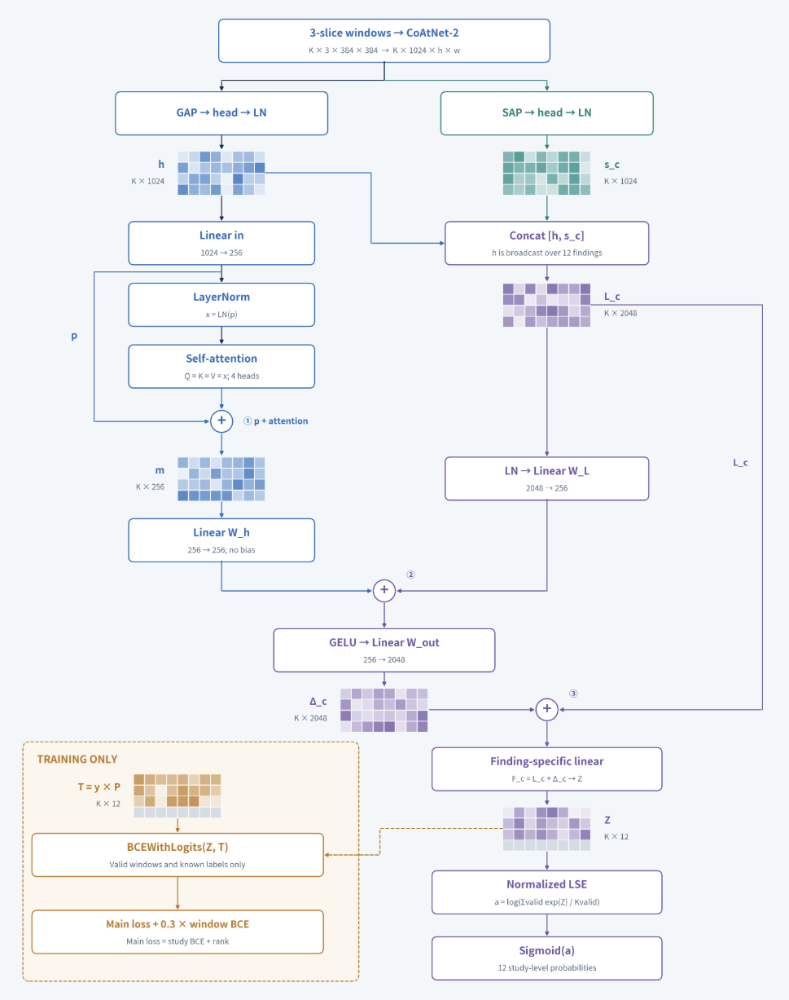
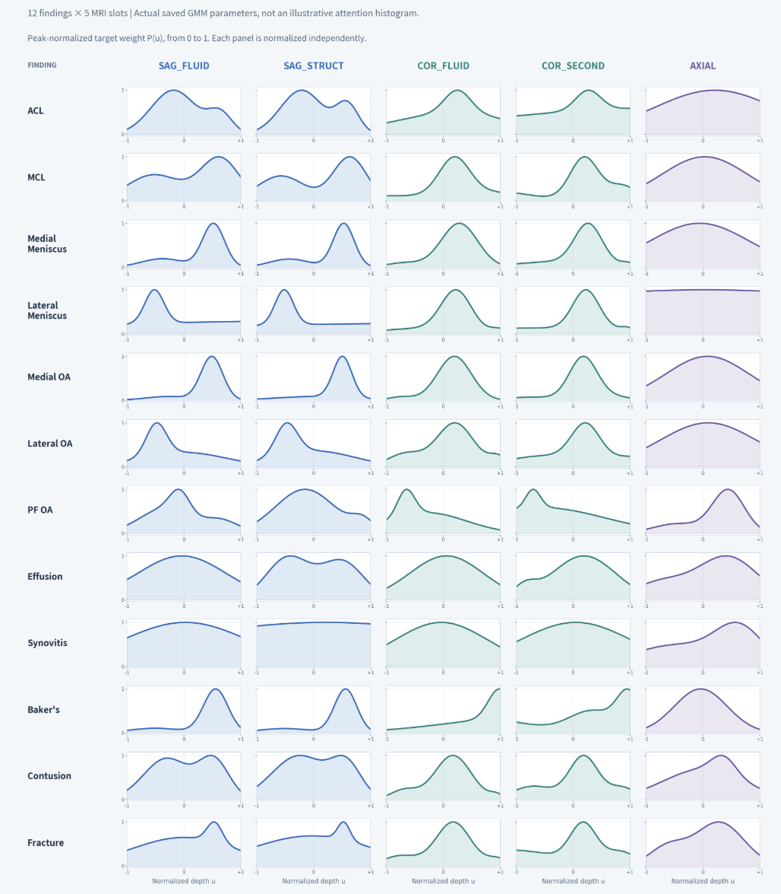
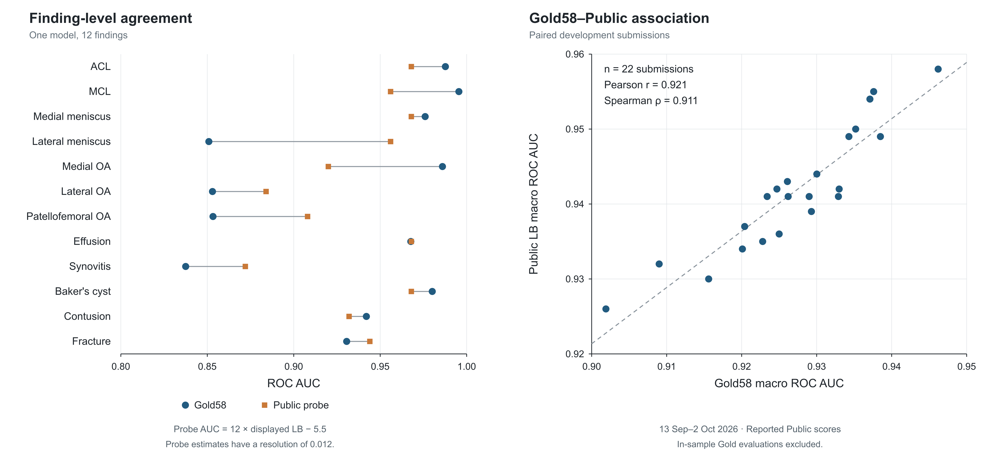

# 8th Place Solution: Image-First Label Distillation and Global–Local View Modeling

Thanks to RSNA and the Kaggle team for hosting this competition, and to my teammates @nantohock and @wadakoki.
Our main approach combined global and local image features across imaging planes and acquisition conditions, alongside improvements to soft labels. We used no additional MRI data.

## 1. DICOM Cache and Augmentation

We increased the number of cached slices per acquisition group to preserve relationships between neighboring slices. We used 5 acquisition groups: sagittal and coronal groups prioritizing either fluid-sensitive or non-fluid-sensitive series, plus an axial group.

| Item | Setting |
|---|---|
| Slice sampling | 32/32/32/32/40 slices from the 5 groups, up to 168 in total |
| Crop size | 140 × 140 mm; also 110 × 110 mm |
| Image size | 384 × 384 pixels |
| Input | A center slice and its immediate neighbors from the same series, stacked as 3 channels |
| Slice spacing | Original spacing retained when the series fits within the slice limit, typically 3–5 mm |

Series exceeding the limit were uniformly subsampled. Late in the competition, we also created sub-series with shifted sampling offsets for series with more than 30 candidate slices. For example, sampling 32 of 96 slices gives 3 variants: slices 1, 4, 7, …, 94; 2, 5, 8, …, 95; and 3, 6, 9, …, 96. During training, we randomly selected a variant, including the standard uniform sample.

The cache was about 110 GB. Public LB was 0.930 with a 64-slice cache and 0.937 with up to 168 slices.

### 1.1 Augmentation

| Augmentation | Setting | Probability and scope |
|---|---|---|
| Brightness | Gain of 0.9–1.1 | Every time, shared across the study |
| Mirroring | Horizontal flip for coronal and axial views; reverse the 3-channel order for sagittal views | 50%, per study |
| Rotation, scaling, translation | ±15°, scale 0.9–1.1, translation ±5% of image width | 50% for the combined transform, per acquisition group |
| Downsampling | Resize each side to 0.5–1.0 of its length, then restore the original size | 25%, per acquisition group |
| Gaussian blur | σ = 0.5–1.0 pixels | 20%, per acquisition group |
| Gaussian noise | Standard deviation 0–0.03 for pixel values in 0–1 | 10%, per acquisition group |
| Series selection, stage 1 | Select 1 series per acquisition group | Randomly each time a study is sampled |
| Sub-series selection, stage 1 | Select the standard sample or an offset variant | Uniformly across candidates |

Mirroring presents the knee as the opposite side. In sagittal views, the left–right direction runs along the slice axis, so we reversed the channel order rather than flipping within the image. Medial and lateral labels remain unchanged.

## 2. Label Improvements

Accurately extracting report content does not necessarily produce labels consistent with image-based evaluation. We therefore incorporated image assessments and model OOF predictions into the training labels.

### 2.1 Report-Based Labels

We prepared 2 sources of report-based labels.

The first, L, averages 3 sets of LLM labels:

- Public labels: report-based LLM labels from [dreaddevelopment/rsna-knee-labels](https://www.kaggle.com/datasets/dreaddevelopment/rsna-knee-labels). For Fracture and Contusion only, we replaced these with GPT-6 Astra's reassessment of the reports.
- Qwen/Gemma: Qwen3.8-27B and Gemma 4 26B-A4B read only the report text with the same prompt and scored cases by severity, amount, and extent. Default scores for unmentioned findings were inferred from the public labels to align the scales. The prompt, settings and code are in [`data/label/wadakoki/`](../data/label/wadakoki/README.md).

The 3 label sets produced similar rankings. Mean per-finding Spearman correlations were 0.898 for Qwen–Gemma, 0.863 for Qwen–public labels, and 0.859 for Gemma–public labels. We averaged all 3 equally to obtain L.

For the second source, A, Astra classified report statements as positive, negative, insufficient evidence, and so on, then assigned soft labels. For unmentioned findings, it estimated probabilities from finding prevalence, omission rates for positive and negative cases, report format, and other findings rather than assigning a constant.

### 2.2 Image-Based Labels

We first gave GPT-6 Astra only the DICOM images, withholding reports and existing labels. We asked it to score its confidence that each of the 12 findings met the competition criteria from 0 to 1. Scores of 0.5 or above were considered positive and required supporting slices and bounding boxes. Reports were reviewed afterward. Discrepancies prompted another image review, with image evidence taking priority.

| Label change | Public LB |
|---|---:|
| Replace public Fracture and Contusion labels with Astra's report reassessment | 0.937 → 0.943 |
| Add Astra's report labels and partial image-label coverage | 0.944 → 0.949 |
| Increase the contribution of image labels and calibrated model predictions | 0.950 → 0.954 |

These are comparisons at major update points; some also include training changes. Image-label coverage was about 20% when Public LB reached 0.949. Eventually, 4,406 of the 4,407 training studies received image assessments.

*Figure 1: Astra image-first labeling. Image-only assessment was followed by report comparison, with discrepancies resolved through another image review.*

### 2.3 Combining Text and Image Labels

We expanded image-label coverage and adjusted the blend per finding. The final labels used 3 sources:

| Symbol | Source |
|---|---|
| I | Astra image assessment |
| L | Equal average of public labels (Fracture and Contusion reassessed by Astra), Qwen labels, and Gemma labels |
| A | Astra report assessment, with unmentioned findings estimated from prevalence and other factors |

We assigned an image weight w per finding and split the remaining weight equally between L and A. Without image labels, L and A were averaged equally.

$$
S = wI + \frac{1-w}{2}\,(L + A).
$$

| Finding | Image weight w |
|---|---:|
| Fracture / Synovitis / Baker's | 5/6 |
| Effusion / Contusion | 2/3 |
| Medial OA | 1/2 |
| ACL / Medial Meniscus / Lateral Meniscus | 1/3 |
| PF OA / Lateral OA / MCL | 1/6 |

We swept a shared image weight across all findings, then selected w at the peak Gold AUC for each finding. A subsequent search varying each weight by ±1/6 produced no difference large enough to justify a change: Gold AUC was 0.9346 vs 0.9348, and Public LB was 0.954 for both. We kept the initial weights.

There were 8 studies containing series from both knees. Study-level labels can incorrectly assign findings from one knee to images of the other. Using the left–right coordinates of series centers, we split 7 studies into 14 knee-level examples. The remaining study was excluded because the opposite knee had only sagittal views and could not be assessed from images. Each knee's labels combined its image assessment and report content using the per-finding weights. Submission inference remained at study level.

### 2.4 Pseudo Labeling

Using S as the target, we generated OOF predictions with 4 folds grouped by scanner characteristics. Positive weighting and the ranking loss shifted mean predictions upward: per-finding OOF means were 0.37–0.46, compared with label means of 0.10–0.40. Before blending, we calibrated OOF predictions to the scale of S. For each fold, we fitted per-finding isotonic regression on the other 3 folds. The training labels y were:

$$
y = 0.6S + 0.4\,\mathrm{OOF}_{\mathrm{cal}}.
$$

We trained separate models using S alone or calibrated OOF labels alone, then blended their predictions on Gold. The best weight for the OOF-trained model was 0.4. Applying this ratio to the training labels and retraining improved Gold AUC from 0.9309 with S alone to 0.9346.

We repeated the process for a second round of self-distillation. A teacher was retrained on the first-round labels y, and its OOF predictions were calibrated and blended at a weight of 0.4. We always blended with S, rather than the previous y, to avoid reducing the contribution of S from 0.6 to 0.36 with successive rounds.

Student Gold AUC, averaged over 4 seeds, improved from 0.9414 in round 1 to 0.9427 in round 2. Round 2 improved on round 1 for 3 of the 4 seeds. These labels were completed just before submission and are the “updated” labels in Section 4.4.

For Gold evaluation experiments, Gold studies were excluded from both teacher training and OOF generation to prevent leakage into student evaluation through pseudo labels.

## 3. Loss Function

We summed BCE with positive-class weighting and an LSE ranking loss, each with coefficient 1. The ranking loss encouraged higher predictions for studies with higher soft labels, exponentially emphasizing larger ranking reversals.

$$
\ell_i^{LSE}=\log\left(1+\frac{1}{M_i}\sum_{j\in J_i}
q_{ij}\exp\left(\frac{s_j-s_i}{T}\right)\right),
\qquad q_{ij}=\max(y_i-y_j,0),\quad T=1.
$$

y is the soft label and s is the logit. J_i is the set of comparison studies with lower labels than study i, and M_i is its size. Comparisons came from the current batch and a queue of logits from recent batches. We averaged the loss per finding over studies with comparison partners (M_i > 0).

We initially tested the effect of a ranking loss using RankNet.

| Loss | Gold AUC | Public LB |
|---|---:|---:|
| BCE only | 0.9261 | 0.943 |
| BCE + RankNet ranking loss | 0.9300 | 0.944 |

The difference between RankNet and LSE was small, but we adopted LSE for its slightly higher Public LB.

## 4. Models and Ensemble

We call a center slice stacked with its immediate neighbors a window. Backbones were CoAtNet-2 (timm's coatnet_rmlp_2_rw_384, pretrained on ImageNet-12k) and CAFormer-S36.

From each window's feature map, GAP produced global features and spatial attention pooling (SAP) produced local features for the 12 findings. SAP weights depended on the finding and acquisition condition. We varied how these features were combined and how windows were aggregated.

### 4.1 Intra-Series GRU and Two-Level Attention

We added embeddings for relative depth within the series, depth gaps to neighboring windows, and acquisition conditions to each window's global features, then passed them through a bidirectional GRU in depth order within each series. Local features bypassed the GRU.

Global and local features were aggregated separately within each series using per-finding attention, then concatenated. This allowed different windows to contribute to global and local assessments. A second per-finding attention layer, conditioned on acquisition conditions, aggregated across series to predict the 12 findings. We also used auxiliary heads for individual imaging planes during training.

*Figure 2: Intra-series GRU and two-level attention. Global features (GAP) are on the left; local features (SAP) on the right.*

### 4.2 LSE and Context Attention Heads

Self-attention over global window features produced context across windows. We used this context and each window's global + local features to compute a residual correction to the window features. We call this context attention + ctx. A variant, context attention + slot, added context from per-finding attention within and across acquisition groups.

The corrected features produced 12 logits per window, aggregated into study-level predictions with log-sum-exp (LSE) per finding.

$$
z_c=\tau\log\left(\frac{1}{K}\sum_{k=1}^{K}\exp(z_{kc}/\tau)\right),\qquad\tau=1.
$$

K is the number of valid windows, and $z_{kc}$ is the logit for finding c in window k. Whereas attention-MIL aggregates features before prediction, this head aggregates window logits.

*Figure 3: LSE and context attention head. The orange box is a window-level auxiliary loss used only during training.*

We also used a depth prior to provide position-dependent window targets. Global-branch window attention weights from teacher OOF inference were aggregated along relative depth for each acquisition condition and finding, then smoothed with Gaussian mixtures.

We normalized each distribution to a peak of 1 and computed BCE against “study soft label × prior at the window's position.” This used the teacher's attention patterns rather than ground-truth lesion locations.

*Figure 4: Depth priors by finding and acquisition condition (columns). The horizontal axis is relative depth within the series; the vertical axis is the target weight, normalized to a peak of 1.*

### 4.3 Union Bag Fine-Tuning (After Training)

In stage 1, we selected 1 series per acquisition group and trained with 24 windows due to memory limits. In stage 2, we froze the backbone and spatial attention and fine-tuned the downstream layers.

Freezing reduced memory use, allowing a union bag of candidate windows from all cached series and sub-series. During training, we randomly selected the number of series and sampling variants, then sampled 32–352 windows.

Continuing to train the classification head tended to overfit early, so we compared head initialization and learning-rate settings. Starting from the same trained CoAtNet model, we trained for another 10 epochs:

| Setting | Fine-tuning learning rate | Gold macro AUC |
|---|---:|---:|
| Before fine-tuning | — | 0.9447 |
| Continue without resetting the head | 3e-5 | 0.9464 |
| Reset and retrain the head | 1e-4 | **0.9507** |

We therefore reinitialized the head before fine-tuning.

### 4.4 Ensemble

We combined models with different backbones, necks, crop sizes, seeds, and training labels. All used 384 × 384 pixel inputs.

A label update just before submission gave us models trained on both the previous and updated labels. Select Submit A used CoAtNet models trained only on the previous labels; B mixed both label versions for its context-attention CoAtNet models. CAFormer models used the updated labels.

| Backbone | Neck | Crop | Models | Training labels | Submission |
|---|---|---|---:|---|---|
| CoAtNet-2 | Intra-series GRU + two-level attention | 140 mm | 4 | Previous: 4 | A |
| CoAtNet-2 | Intra-series GRU + two-level attention | 110 mm, shifted 10 mm anteriorly | 4 | Previous: 4 | A |
| CoAtNet-2 | Context attention + ctx (LSE) | 140 mm | 4 | Previous: 2, updated: 2 | B |
| CoAtNet-2 | Context attention + slot (LSE) | 140 mm | 4 | Previous: 2, updated: 2 | B |
| CAFormer-S36 | Intra-series GRU + two-level attention | 140 mm | 4 | Updated: 4 | Shared by A/B |
| CAFormer-S36 | Intra-series GRU + two-level attention | 110 mm, shifted 10 mm anteriorly | 3 | Updated: 3 | B |

The 110 mm crop was shifted 10 mm anteriorly from the center. The 4 CAFormer models with 140 mm crops were shared by A and B; the 3 with 110 mm crops were used only in B. Numbers in the label column are model counts.

#### Select Submit A

Our Public Best combination used 12 intra-series GRU + two-level attention models (8 CoAtNet + 4 CAFormer), with equal-weight probability averaging. We selected the EMA checkpoint with the best Gold score, using epoch 4 EMA if the best epoch was earlier than 4. Inference used a union bag of 384 windows with no TTA.

#### Select Submit B

We chose the combination with the highest Gold macro AUC. It used 4 groups: context attention + ctx, context attention + slot, CAFormer with 140 mm crops, and CAFormer with 110 mm crops. Probabilities were averaged equally within each group, then equally across the 4 groups.

On Gold, context attention + ctx scored 0.9508 and context attention + slot scored 0.9492; averaging the 2 equally gave 0.9527.

## 5. Validation with Gold and Public LB

OOF performance against soft labels alone does not establish performance against image-based evaluation labels. We used Gold, the 58 studies labeled by physicians, for validation and checked its agreement with Public LB.

For per-finding comparisons, we kept predictions for 1 finding and fixed the other 11 columns at 0.5. We estimated Public AUC for that finding as AUC = 12 × LB − 5.5. Since LB is displayed to 3 decimal places, the converted AUC has a step size of 0.012.

*Figure 5: Left: per-finding AUC for 1 model on Gold and estimated from Public LB probes. Right: Gold macro AUC and Public LB across 22 submissions.*

Gold and Public per-finding AUCs were close for Effusion and Medial Meniscus, but differed by about 0.07–0.1 for Lateral Meniscus and Medial OA. Across 22 submissions, Gold macro AUC and Public LB were positively correlated (Pearson r = 0.921, Spearman ρ = 0.911).

We treated absolute Gold scores and small differences cautiously, using Gold mainly to track overall improvement. We prioritized fast experiments on Gold over training 4 models for complete OOF predictions each time, while watching for overfitting to Public LB.

## 6. Final Results

| Submission | Public | Private |
|---|---|---|
| Public Best (Select Submit A) | 0.968 | 0.957 |
| Gold macro AUC priority (Select Submit B) | 0.967 | 0.957 |
| Highest Private score (not selected) | 0.967 | 0.958 |

Scores are the currently displayed values. We will add the rank and more precise scores once the standings are finalized.

## References

1. Dai et al., [CoAtNet: Marrying Convolution and Attention for All Data Sizes](https://arxiv.org/abs/2106.04803), NeurIPS 2021
2. Guan et al., [Diagnose like a Radiologist: Attention Guided Convolutional Neural Network for Thorax Disease Classification](https://arxiv.org/abs/1801.09927), arXiv 2018
3. Ilse et al., [Attention-based Deep Multiple Instance Learning](https://proceedings.mlr.press/v80/ilse18a.html), ICML 2018
4. Shao et al., [TransMIL: Transformer based Correlated Multiple Instance Learning for Whole Slide Image Classification](https://arxiv.org/abs/2106.00908), NeurIPS 2021
5. Li et al., [Dual-stream Multiple Instance Learning Network for Whole Slide Image Classification with Self-supervised Contrastive Learning](https://arxiv.org/abs/2011.08939), CVPR 2021
6. Pinheiro & Collobert, [From Image-Level to Pixel-Level Labeling With Convolutional Networks](https://openaccess.thecvf.com/content_cvpr_2015/html/Pinheiro_From_Image-Level_to_2015_CVPR_paper.html), CVPR 2015
7. Burges et al., [Learning to Rank using Gradient Descent](https://www.microsoft.com/en-us/research/publication/learning-to-rank-using-gradient-descent/), ICML 2005
8. Lin et al., [Reference-Guided Gradient Balancing Loss for Long-Tailed Multi-Label Medical Image Classification](https://papers.miccai.org/miccai-2026/paper/0566_paper.pdf), MICCAI 2026
